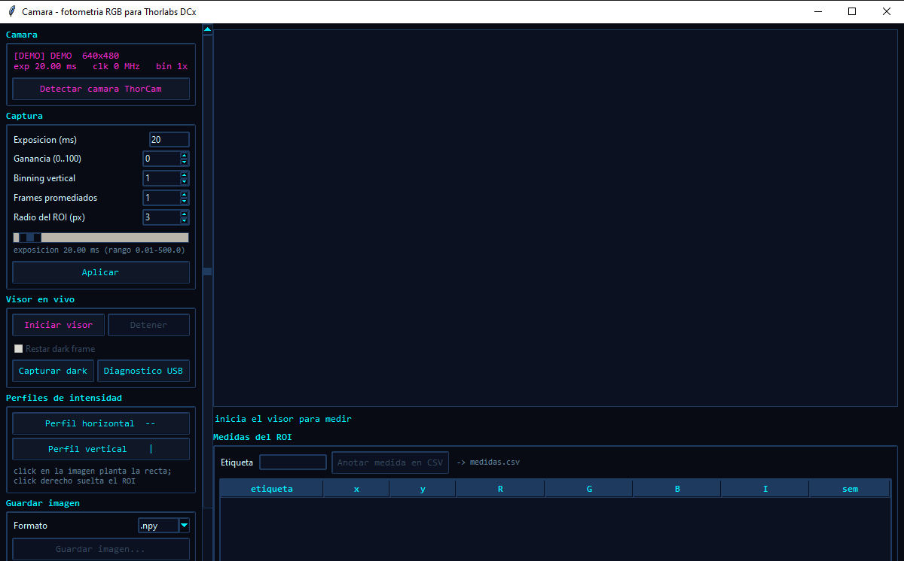
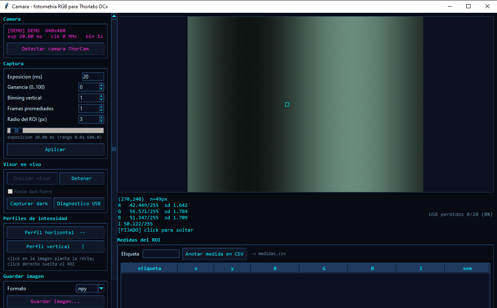
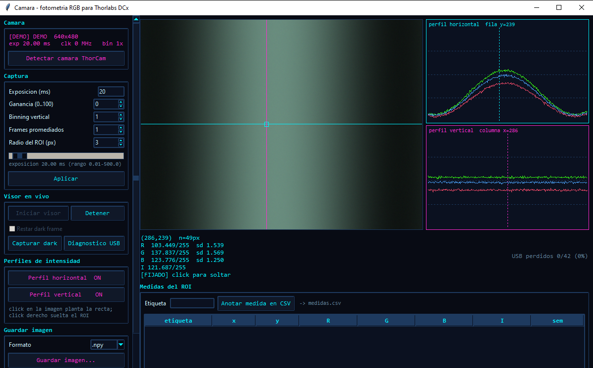
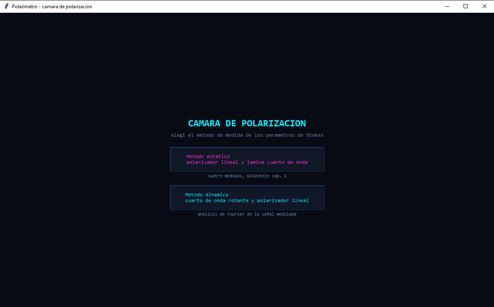
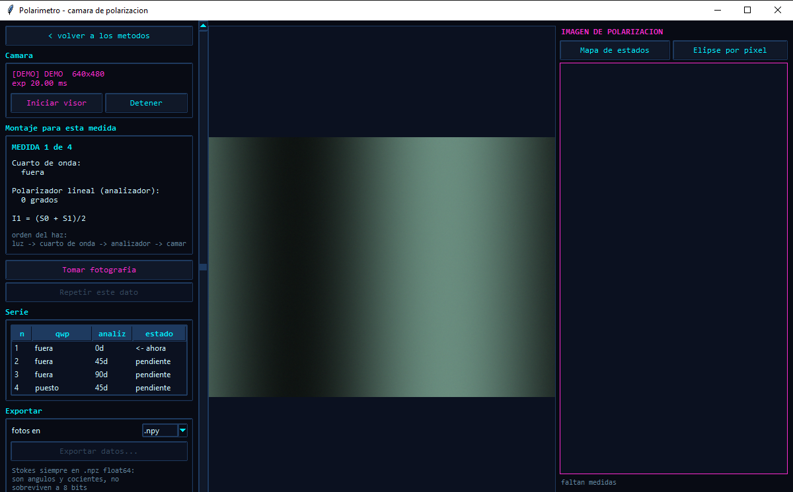
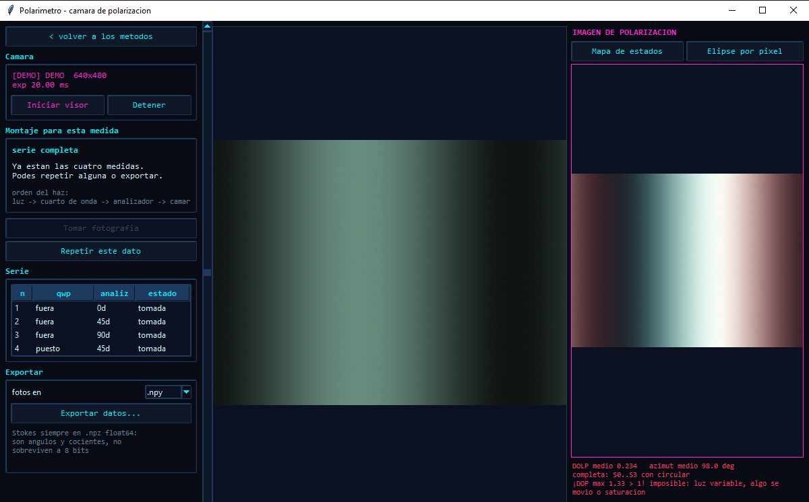
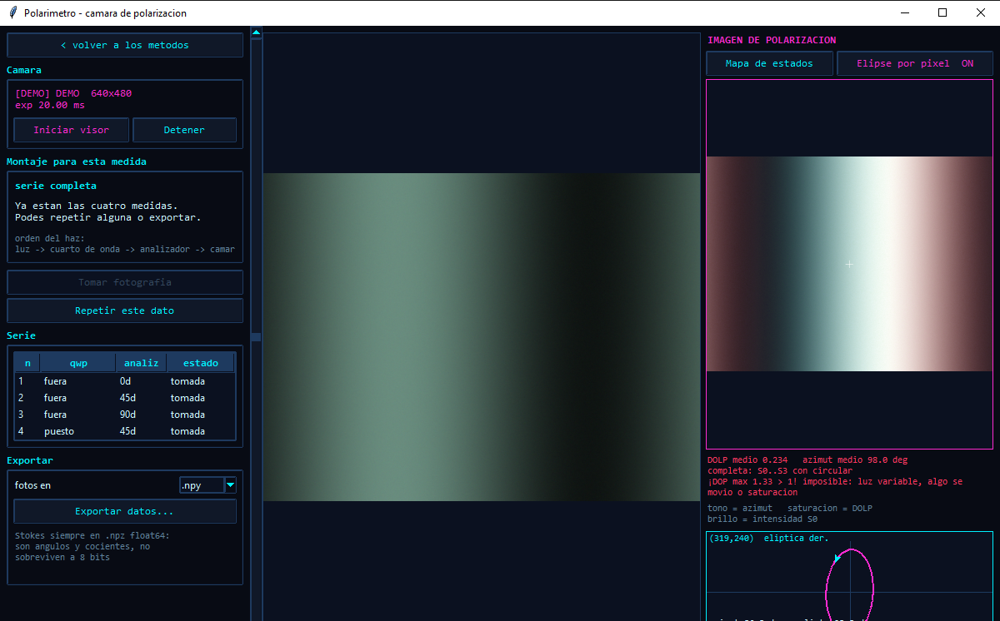
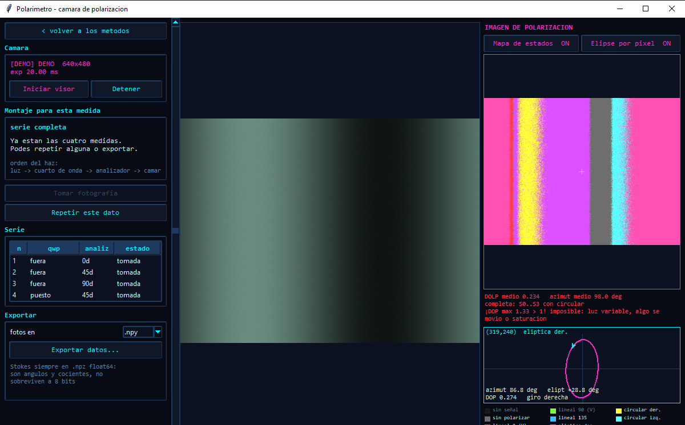

# camara-jafert

Dos programas para cámaras Thorlabs DCx, probados contra una **DCU224C**
(1280x1024, sensor color, píxel de 4.65 um):

| | Archivo | Ejecutable | Para qué |
|---|---|---|---|
| **Cámara** | `camara.py` | `camara.exe` | visor en vivo, lectura RGB decimal, perfiles, dark frame, guardado |
| **Polarímetro** | `polarimetro.py` | `polarimetro.exe` | arma la imagen de polarización midiendo los parámetros de Stokes |

`polarimetro.py` importa de `camara.py` la capa de cámara, el guardado y el
estilo de la interfaz: el driver está escrito una sola vez.

Las dependencias van declaradas en cada script (PEP 723), así que `uv` arma el
entorno solo: no hay que crear venv ni instalar nada a mano.

---

# Tutorial

Las capturas de esta sección están tomadas en **modo demo** (`--demo`, patrón
sintético, sin cámara conectada), por eso aparece la etiqueta `[DEMO]`. Con la
cámara real la ventana es idéntica; solo cambia la imagen. Para empezar basta
con doble click en `camara.exe` o `polarimetro.exe` (o `uv run camara.py` /
`uv run polarimetro.py`).

## Cómo usar el software de la cámara

1. **Abrir el programa.** Si la cámara estaba apagada al abrirlo, enchúfala y
   pulsa **Detectar cámara ThorCam** (panel *Cámara*): engancha la primera
   cámara libre sin reiniciar. Sin cámara el programa ofrece seguir en demo.

   

2. **Ajustar la captura** (panel *Captura*): exposición en ms, ganancia,
   binning vertical, frames promediados y radio del ROI. La barra de
   exposición actúa en vivo; el resto se aplica con **Aplicar**. Conviene
   subir la exposición antes que la ganancia hasta que la señal entre en escala.

3. **Iniciar el visor** (panel *Visor en vivo*). Aparece la imagen en vivo; al
   mover el mouse sobre ella el recuadro marca el ROI y debajo se lee el valor
   **R, G, B e I** con decimales y su desviación (`sd`). **Click izquierdo**
   fija el ROI en ese punto; **click derecho** lo suelta.

   

4. **Perfiles de intensidad.** **Perfil horizontal** y **Perfil vertical**
   abren a la derecha dos gráficos con los canales R, G y B del corte que pasa
   por el punto donde hiciste click (cian la horizontal, magenta la vertical).

   

5. **Medir y guardar.**
   - Escribe una *Etiqueta* y pulsa **Anotar medida en CSV** para agregar el
     ROI actual a la tabla y a `medidas.csv`.
   - Con la tapa puesta, **Capturar dark** guarda el piso de oscuridad
     (`dark.npy`); marca **Restar dark frame** para descontarlo.
   - **Guardar imagen...** escribe el frame promediado en `.npy`, `.tiff`,
     `.png` o `.jpg` (elige el formato arriba del botón). Los dos primeros
     conservan los decimales.

## Cómo usar el software de la cámara de polarización

1. **Abrir `polarimetro.exe`** (o `uv run polarimetro.py`). La primera pantalla
   pide el método de medida: elige **Método estático** (polarizador lineal y
   lámina de cuarto de onda fijos). El dinámico aún está en construcción.

   

2. **Iniciar el visor** (panel *Cámara*). Aparece la imagen en vivo en el
   centro. En *Montaje para esta medida* el programa dice cómo colocar la
   lámina de cuarto de onda y el analizador para cada una de las 4 medidas.
   Recuerda el orden del haz: `luz → cuarto de onda → analizador → cámara`.

   

3. **Tomar las 4 fotografías.** Coloca los elementos como indica la guía y
   pulsa **Tomar fotografía**; repite hasta completar la serie (la tabla
   *Serie* marca cuál sigue). Si algo se movió o se saturó, **Repetir este
   dato** descarta la última y la vuelve a pedir. A la derecha, la **imagen de
   polarización** se rearma con cada medida: tono = azimut, saturación = grado
   de polarización lineal, brillo = intensidad S₀.

   

4. **Elipse por pixel.** Activa **Elipse por pixel** y haz click en un punto de
   la imagen de polarización: debajo se dibuja la elipse de ese píxel, con su
   azimut, elipticidad, DOP y el nombre del estado.

   

5. **Mapa de estados.** **Mapa de estados** clasifica cada píxel (lineal 0°/45°/
   90°/135°, elíptica o circular derecha/izquierda, sin polarizar) y pone la
   leyenda al pie.

   

6. **Exportar.** **Exportar datos...** guarda las fotografías en el formato
   elegido y los mapas de Stokes en `.npz` float64 (más el falso color en PNG).

> **Aviso en rojo «DOP > 1».** En las capturas de demo aparece porque el patrón
> sintético cambia entre una toma y otra. Con montaje real significa que las
> cuatro fotos no describen el mismo estado (la luz varió, algo se movió o hubo
> píxeles saturados): hay que repetir las medidas.

---

# Cámara

## Uso

Sin argumentos abre la **interfaz gráfica** (Tkinter), que es la forma normal de
usarlo — no hace falta la terminal:

```bash
uv run camara.py
```

```
┌─ Camara ─────────┐ ┌─────────────────────────────────────┐
│ D1280G12C 1280x… │ │                                     │
│ [Detectar ThorCam]│ │       imagen en vivo, con el        │
├─ Captura ────────┤ │       recuadro del ROI sobre        │
│ Exposicion   20  │ │       la posicion del mouse         │
│ Ganancia      0  │ │                                     │
│ Binning       1  │ └─────────────────────────────────────┘
│ Frames        1  │  (320,240) n=49px
│ ROI           3  │  R  128.4375/255  sd 1.732
│    [Aplicar]     │  G  130.0204/255  sd 1.664
├─ Visor en vivo ──┤  B  126.8776/255  sd 1.701
│ [Iniciar visor]  │ ┌─ Medidas del ROI ───────────────────┐
│ [Detener]        │ │ Etiqueta [    ] [Anotar en CSV]     │
│ ☐ Restar dark    │ │ etiqueta   x    y     R       G     │
│ [Capturar dark]  │ │ fondo     320  240  128.43  130.02  │
│ [Diagnostico]    │ │ muestra   410  188  119.10  121.55  │
├─ Perfiles ───────┤ └─────────────────────────────────────┘
├─ Guardar imagen ─┤
│ Formato [.npy]   │
│ [Guardar imagen] │
│ [Guardado rapido]│
└──────────────────┘
```

El estilo es **nocturno tipo cyberpunk** (fondo casi negro, acentos de neón
cian y magenta). Aparte del gusto, en un laboratorio de óptica se trabaja a
oscuras: una ventana blanca encandila y mete luz parásita en la medida.

La **barra de exposición** la aplica en vivo, sin pasar por *Aplicar*: es el
parámetro que uno busca a tientas hasta que la señal entra en escala, y con el
visor corriendo se ve el efecto al instante. El rango sale de la propia cámara
(`is_Exposure` con `RANGE_MIN`/`RANGE_MAX`), y el valor que se muestra es el que
devolvió el hardware, que redondea al reloj real.

## Perfiles de intensidad

Los botones **Perfil horizontal** y **Perfil vertical** abren, a la derecha de
la imagen, dos gráficos apilados que se actualizan en vivo. La recta se planta
**donde uno hace click** sobre la imagen (click derecho suelta el ROI), y queda
dibujada sobre ella: cian la horizontal, magenta la vertical, igual que el borde
de su panel.

Cada gráfico traza los tres canales R, G y B del corte completo, con grilla en
64/128/192 y una marca punteada en la posición del ROI. La imagen se queda con
todo el ancho que sobra: la columna de perfiles es de ancho fijo y desaparece
cuando los dos están apagados.

Para dibujar, el corte se submuestrea a los píxeles que entran en el ancho del
panel. Se submuestrea en vez de promediar a propósito: un promedio escondería
los picos angostos, que son justo lo que uno busca en un perfil.

Los botones de guardado y de medida **se habilitan al iniciar el visor en
vivo**, que es cuando existe un frame promediado para escribir.

**Detectar camara ThorCam** enumera las cámaras DCx conectadas (`is_GetNumberOfCameras`
/ `is_GetCameraList`) y engancha la primera libre, mostrando modelo y número de
serie. Sirve para el caso habitual de haber abierto el programa antes de
prender la cámara, o haber cambiado de puerto: no hace falta reiniciar. Si el
SDK responde pero no hay nada enchufado, lo dice; si falta el SDK, explica eso
en vez de fallar en silencio.

El menú de texto viejo sigue disponible, y también el visor de OpenCV:

```bash
uv run camara.py --menu            # menu interactivo en la terminal
uv run camara.py --viewer -b 4 -a 8 -R 5   # visor de OpenCV, sin la GUI
uv run camara.py --demo            # sin camara conectada (abre la GUI)
uv run camara.py --self-test       # tests
uv run camara.py --benchmark       # tasa de error del enlace USB
```

## Guardado

| Formato | Por píxel | Para qué |
|---|---|---|
| **`.npy`** (por defecto) | `float64` exacto | medir |
| `.tiff` | float de 32 bits | medir, y abrirlo en ImageJ/Fiji |
| `.png` | entero 0..255 | mirar, informes |
| `.jpg` | entero 0..255, con pérdida | mirar, compartir |

Los dos primeros conservan los decimales; PNG y JPG redondean. Los decimales no
salen del ADC — que entrega enteros de 8 bits — sino de sumar señal: binning en
el CCD, promedio espacial del ROI y promedio temporal de varios frames. Lo que
se guarda es el frame ya promediado (y con el dark restado, si está activado),
así que sus valores son fraccionarios de verdad.

En el visor de OpenCV (`--viewer`) la tecla `c` hace el mismo guardado rápido,
escribiendo los dos formatos con timestamp.

## Binning por hardware

El CCD suma la carga de varias filas **antes del ADC**, asi que la mejora es
analogica y ocurre antes del ruido de lectura. Medido sobre una DCU224C a 20 ms:

| Modo | Alto | SNR relativo |
|------|-----:|-------------:|
| sin binning | 1024 | 1.00x |
| 2x vertical | 512 | 1.62x |
| 3x vertical | 341 | 2.22x |
| 4x vertical | 256 | 2.34x |

Cuesta resolucion vertical, que para medir un punto no importa.

**Advertencia:** el sensor es Bayer y las filas alternan filtros de color, asi
que al binear se mezclan. Con binning los canales R/G/B dejan de ser colores
limpios. Para fuente monocromatica da igual; si el color importa, binning 1x.

## Dark frame

El sensor tiene un piso de oscuridad distinto en cada canal (del orden de
25/19/13 en la DCU224C). Ese offset es sistematico: no se va promediando y
aplasta el contraste de las señales debiles. La GUI tiene el boton para
capturarlo con la tapa puesta; queda en `dark.npy` y se resta automaticamente.
En el visor de OpenCV se activa y desactiva con la tecla `d`.

## De dónde sale la precisión sub-nivel

La primera y más eficaz ganancia **la aporta la cámara**, no el software: el
binning suma la carga de varias filas **dentro del CCD, antes del ADC**. Es una
operación analógica que ocurre antes del ruido de lectura, y por eso rinde más
que cualquier procesamiento posterior. Medido sobre esta DCU224C: **2.34× de
relación señal-ruido** con binning 4x. Eso es hardware puro.

Sobre esa base, el programa suma señal en dos etapas más:

| Etapa | Dónde ocurre | Ganancia |
|-------|--------------|----------|
| Binning | en el CCD, antes del ADC | 2.34× SNR (medido) |
| Promedio espacial del ROI | (2r+1)² píxeles | ÷√n en el error |
| Promedio temporal | varios frames (`-a`) | ÷√N en el error |

Conviene saber qué entrega el sensor para no atribuirle de más: cada fotosito
sale del ADC como un **entero de 0 a 255**. No hay mayor profundidad
disponible — los modos de 10, 12 y 16 bits los rechaza con
`IS_INVALID_COLOR_FORMAT`, verificado sobre la cámara. Ningún ADC entrega
fracciones; los decimales aparecen al sumar señal, que es el procedimiento
estándar en fotometría cuantitativa.

Lo que importa para un ajuste es la **incertidumbre**, y el CSV la guarda: el
error estándar de la media por canal. Con binning 4x, ROI de 11×11 y 8 frames
baja al orden de **0.02 niveles**, es decir precisión equivalente a unos 12
bits partiendo de un sensor de 8. Se paga en tiempo, no en resolución.

## Respuesta lineal

Al abrir la cámara se apagan gamma (queda en 1.0), gamma de hardware,
auto-ganancia, auto-exposición, balance de blancos automático, corrección de
color, gain boost y compensación de negro. Cualquiera de esas etapas rompe la
proporcionalidad entre señal e intensidad incidente y deforma una curva de
Malus. Por el mismo motivo conviene subir exposición antes que ganancia.

El sensor tiene un piso de oscuridad de unos 19 niveles, distinto por canal
(R 25, G 19, B 13 con la tapa puesta). Para medidas absolutas hay que capturar
un dark frame y restarlo.

## Plataformas

La captura necesita el SDK **DCx Camera Support** de Thorlabs, que existe para
Windows y Linux/amd64 únicamente. **No hay driver para macOS**, ni de Thorlabs
ni de IDS, que es el fabricante original de estas cámaras.

| | Captura | Demo, tests y análisis |
|---|---|---|
| Windows + SDK | sí | sí |
| macOS | no | sí |
| Linux amd64 | requiere adaptar el cargador a `libueye_api.so` | sí |

El módulo declara los tipos de Windows a mano en lugar de importar
`ctypes.wintypes`, así que se importa en cualquier sistema. Fuera de Windows,
`UC480Camera` falla con un mensaje explícito y el resto del programa funciona
igual: `--demo`, `--self-test` y cualquier análisis sobre CSV ya guardados.

Portar el driver a macOS no es recompilar: el protocolo USB de uEye es
propietario y sin documentar, y el driver le sube firmware a la cámara al
conectarla (el PID cambia de `1000` a `2240` en ese momento). Sería un
proyecto de ingeniería inversa, no una adaptación.

Aparte del SDK, lo único que hace falta es [uv](https://docs.astral.sh/uv/).

## Generar un .exe (Windows)

Para distribuir el visor a una maquina sin `uv` ni Python, se empaqueta con
[PyInstaller](https://pyinstaller.org/) en modo *onefile*:

```bash
pip install numpy opencv-python questionary rich pytest pyinstaller
pyinstaller --onefile --name camara --windowed --add-data "camara.py;." camara.py
pyinstaller --onefile --name polarimetro --windowed \
            --add-data "polarimetro.py;." --add-data "camara.py;." polarimetro.py
```

Los `.exe` quedan en `dist/` y corren standalone: doble click abre la
interfaz gráfica, sin ninguna terminal detrás. Los modos de línea de comandos
(`--demo`, `--viewer`, `--self-test`, `--benchmark`) siguen funcionando si se lo
invoca con argumentos; `--menu`, que es interactivo, hay que lanzarlo desde una
consola real porque el ejecutable ya no trae una propia.

Dos detalles del empaquetado:

- `--windowed` es lo que evita la terminal negra. A cambio el ejecutable no
  tiene consola propia, así que al arrancar con argumentos el programa se
  engancha a la consola desde la que lo llamaron (`AttachConsole`) para que
  `--self-test` y `--benchmark` puedan imprimir ahí.
- `--add-data` es necesario porque `--self-test` invoca a pytest sobre el
  propio archivo fuente, y PyInstaller no lo deja en disco a menos que se
  declare explícitamente como dato.

La captura real (`UC480Camera`) sigue necesitando el SDK **DCx Camera
Support** de Thorlabs instalado en esa maquina — el `.exe` no lo embebe, igual
que no lo instala `uv run`.

## Nota sobre el enlace USB

La DCU224C mueve 3.93 MB por frame en color sobre USB 2.0. En el equipo donde
se desarrolló esto, `is_FreezeVideo` devuelve `IS_TRANSFER_ERROR` de forma
intermitente en buena parte de las capturas, y la tasa de error escala con los
bytes por frame en lugar de con la velocidad, lo que apunta al cable o al
conector más que al ancho de banda. El visor lo absorbe con reintentos y
descartando frames, y muestra la tasa de pérdida en pantalla.

`--benchmark` mide esa tasa para cada pixel clock; sirve para comparar cables
con números en vez de intuición. Un enlace sano debería dar ~0% en todas las
filas.

---

# Polarímetro

```bash
uv run polarimetro.py              # interfaz grafica
uv run polarimetro.py --demo       # sin camara
uv run polarimetro.py --self-test  # tests de la fisica
```

Arma la **imagen de polarización** píxel a píxel: mide los cuatro parámetros de
Stokes y de ahí saca, para cada punto de la escena, cuánta luz está polarizada,
en qué dirección vibra y con qué elipticidad.

Abre en un menú con los dos métodos:

- **Método estático** — polarizador lineal y lámina cuarto de onda fijos.
  Implementado.
- **Método dinámico** — cuarto de onda rotante y polarizador lineal fijo.
  Por ahora avisa que está en construcción y vuelve al menú.

## El método estático

Es el método clásico de **Goldstein, *Polarized Light*, cap. 6** ("Measurement
of the Stokes Polarization Parameters"). Con el haz atravesando primero un
retardador de retardancia φ y después un analizador lineal a ángulo θ:

```
I(θ,φ) = ½ [S₀ + S₁cos2θ + S₂sin2θ·cosφ + S₃sin2θ·sinφ]
```

**El orden importa:** el cuarto de onda va *antes* del polarizador en el camino
del haz — `luz → cuarto de onda → analizador → cámara`. Al revés, el analizador
dejaría pasar luz ya polarizada linealmente y el retardador no tendría
componente circular que convertir: S₃ se volvería invisible.

De esa ecuación salen las cuatro medidas, que el software va pidiendo una por
una indicando cómo poner cada elemento:

| Medida | Cuarto de onda | Analizador | Mide |
|---|---|---|---|
| 1 | fuera | 0° | I₁ = (S₀+S₁)/2 |
| 2 | fuera | 45° | I₂ = (S₀+S₂)/2 |
| 3 | fuera | 90° | I₃ = (S₀−S₁)/2 |
| 4 | puesto, eje rápido a 0° | 45° | I₄ = (S₀+S₃)/2 |

La inversión es directa y exacta, sin ajuste ni mínimos cuadrados:

```
S₀ = I₁ + I₃      S₁ = I₁ − I₃      S₂ = 2I₂ − S₀      S₃ = 2I₄ − S₀
```

## Construcción en vivo

La imagen de polarización se recalcula **con cada medida que entra**, no al
final. Desde la tercera ya se puede mostrar la parte lineal (DOLP y azimut); S₃
recién aparece con la cuarta, y hasta entonces el panel avisa que lo que se ve
es parcial.

El mapa en falso color usa la convención habitual: **tono = azimut**,
**saturación = grado de polarización lineal**, **brillo = intensidad S₀**. El
color dice en qué dirección vibra la luz y lo saturado dice cuánta de esa luz
está polarizada.

**Repetir este dato** descarta la última medida y vuelve a pedirla, para cuando
se movió algo o quedó saturada.

## Las dos visualizaciones

Sobre la imagen de polarización hay dos botones, que se pueden usar a la vez:

**Elipse por píxel** — al hacer click en un punto de la imagen dibuja la elipse
de polarización de ese píxel: la figura que traza el campo eléctrico. Los
semiejes salen de A²+B² = I_pol junto con B/A = |tan χ|, la inclinación es el
azimut, y una flecha sobre el trazo marca el sentido de giro, que es lo único
que distingue una elipse derecha de su espejo izquierdo. Debajo muestra azimut,
elipticidad, DOP y el nombre del estado.

**Mapa de estados** — en vez del continuo de colores, clasifica cada píxel en un
estado con nombre y lo pinta con su color, con leyenda al pie (los estados que
no aparecen en la imagen van atenuados). Responde directo "¿qué hay acá?" en
lugar de obligar a interpretar un tono:

| | Criterio |
|---|---|
| sin señal | S₀ < 5% del máximo — sin dato, no se inventa |
| sin polarizar | DOP < 0.15 |
| lineal 0/45/90/135 | \|χ\| < 10°, por banda de azimut de ±22.5° |
| elíptica der./izq. | 10° < \|χ\| < 35°, signo de S₃ |
| circular der./izq. | \|χ\| > 35°, signo de S₃ |

Los umbrales son convenciones de lectura, no física: la polarización es un
continuo y los cortes solo sirven para ponerle nombre. Están declarados juntos
al principio del archivo para poder cambiarlos.

## Control de sanidad

Un **DOP mayor que 1 es físicamente imposible**. Si aparece, el panel lo avisa
en rojo: significa que las cuatro fotos no corresponden al mismo estado, casi
siempre porque la luz cambió entre tomas, algo se movió, o hubo píxeles
saturados. Es la comprobación que delata un error de montaje antes de que
termine en el informe.

## Exportación

Las fotografías salen en el formato que elija el usuario (`.npy`, `.tiff`,
`.png` o `.jpg`). Los mapas de Stokes van **siempre a `.npz` de float64**, y no
es una preferencia: son ángulos en grados (azimut 0–180, elipticidad ±45) y
cocientes entre −1 y 1. En un PNG de 8 bits un azimut de 47.3° y uno de 47.9°
serían el mismo número, y un DOP de 0.004 sería cero. Se agrega además el falso
color como PNG, para mirar.

El `.npz` trae `S0 S1 S2 S3 DOP DOLP DOCP azimut elipticidad`, todos en
float64 y del tamaño de la imagen.

## Qué está verificado

Los tests (`--self-test`) comprueban la física contra estados de referencia
conocidos, no solo que el código corra: se simulan las cuatro medidas sobre un
estado de Stokes dado y se verifica que la inversión lo recupere. Cubren lineal
horizontal/vertical/±45, circular derecha e izquierda, luz sin polarizar y una
mezcla parcial; que I(θ) se reduzca a la ley de Malus sin retardador; que el
azimut y la elipticidad den los valores de libro; y que los píxeles sin luz no
produzcan `NaN` que contaminen la imagen.
